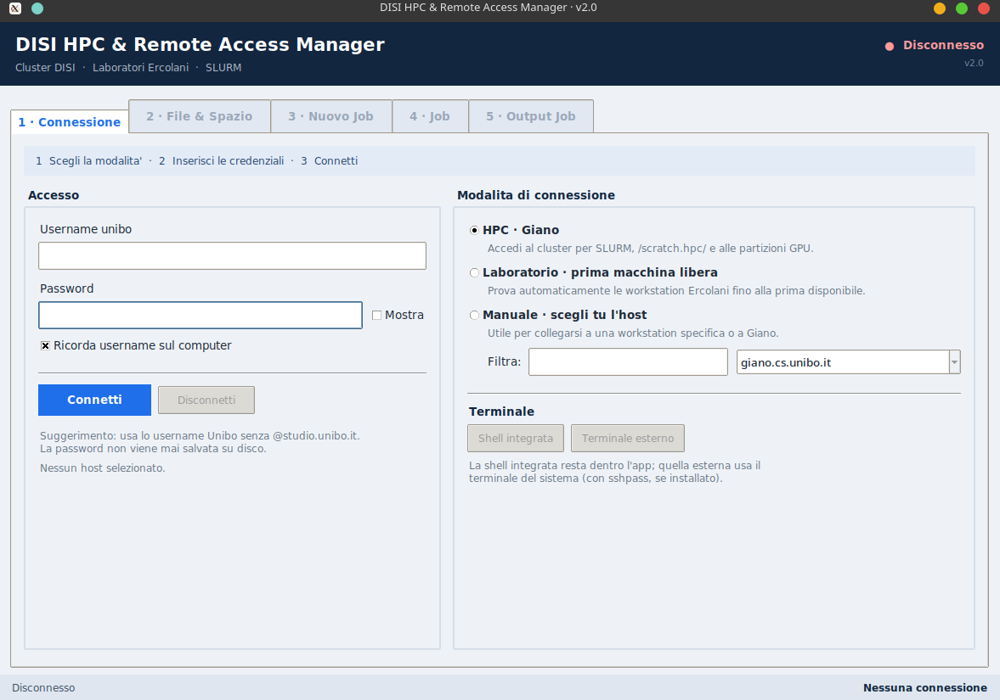

Disi Cluster Manager
================================

<p align="center">
  
</p>

Questo tool ha lo scopo di semplificare la vita allo studente e al ricercatore. Con una semplice gui puoi connetterti ai server di dipartimento e organizzare i tuoi file(explorer, upload e download di progetti, organizzazione spazio e usare un editor integrato)  e  creare/submittare job con un'interfaccia grafica sapendo in tempo reale quali nodi sono occupati e quali liberi.


Potresti fare tutto questo dal terminale? si, tranquillamente. 


È uno sbatti in più? si. 


Ogni tanto voglio solo finire il lavoro il prima possibile senza dover capire gli errori che mi da rsync(il 90% non hai più spazio) o scrivermi sempre la sintassi per scrivere gli script slurm o ricordarmi i nomi dei pc di dipartimento.


Se da remoto devi modificare un file se non sai usare vim(task più difficile per un developer dopo centrare un div) puoi aprire l'editor remoto facendo doppio click sul file(non ti aspettare vscode).

Puoi usare la shell integrata nel caso ti servisse.

Installazione e uso
------------

installa le dipendenze con:

```bash
  pip install paramiko
```

e lancia lo script :

```bash
  python3 hpc_disi_gui.py
```

Risorse Utili
------------

- [slurm-job-template-disi](https://github.com/lozingaro/slurm-job-template-disi)
- [cluster-hpc](https://disi.unibo.it/en/department/organisation-and-people/it-services/cluster-hpc)
- [accesso-remoto](https://disi.unibo.it/it/dipartimento/organizzazione/servizi-informatici/accesso-remoto)